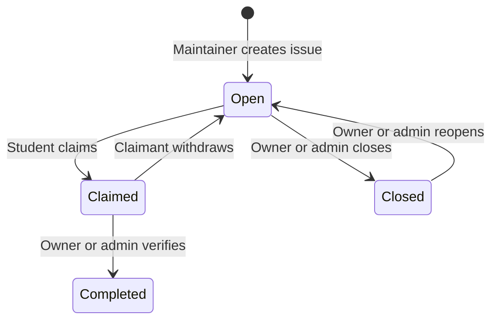
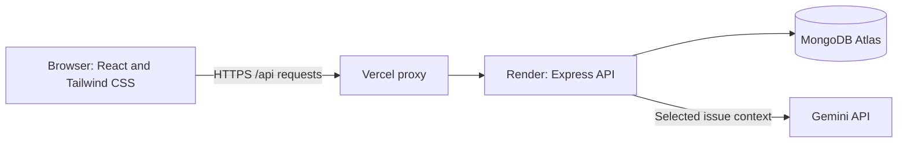

# COSH application documentation

COSH is a campus collaboration app where maintainers publish open-source projects and students find, claim, and complete issues. This guide covers using the app and how its main components work. For installation, environment variables, and the live application and video links, see the [README](README.md).

## Contents

- [Accounts and permissions](#accounts-and-permissions)
- [Student workflow](#student-workflow)
- [Maintainer workflow](#maintainer-workflow)
- [Issue lifecycle](#issue-lifecycle)
- [Recommendations](#recommendations)
- [Technical architecture](#technical-architecture)
- [API reference](#api-reference)
- [Failures and troubleshooting](#failures-and-troubleshooting)
- [Scope and limitations](#scope-and-limitations)

## Accounts and permissions

Register with a name, email address, password, and either **Student** or **Project maintainer**. Passwords must contain at least eight characters. Registration signs the new account in; returning users use the login page.

| Action | Student | Maintainer | Admin |
| --- | --- | --- | --- |
| Browse projects and issues; edit own profile | Yes | Yes | Yes |
| Request issue recommendations | Yes | No | No |
| Claim an open issue; withdraw own claim | Yes | No | No |
| Create a project | No | Yes | Yes |
| Manage projects and issues | No | Own projects | Any project |
| Verify a claimed contribution | No | Own projects | Any project |

Admin accounts cannot be created through public registration. Profile editing changes the name, bio, and skills; it does not change the email, password, or role.

The dashboard greets users by their saved name. For example, **Demo Maintainer - Asha Rao** is an account name, not a special dashboard mode. The role badge in **Your Account** shows the actual role. Being a maintainer does not give access to another maintainer's project controls.

## Student workflow

### Set up a profile

1. Log in with a student account.
2. On the dashboard, click **Profile**.
3. Enter a name and bio. In **Skills**, enter comma-separated skills such as `React, CSS, JavaScript`.
4. Click **Save Profile** and wait for the success message.
5. Click **Back to dashboard**.

### Discover and claim work

1. Click **Browse issues →** on the dashboard.
2. Enter search text or choose filters for technology, required skill, difficulty, and status. For example, choose **Beginner** and **Open**.
3. Click **Find issues**. Use **Clear filters** to return to the full list.
4. Click **View issue →** on a result and read the description and required skills.
5. Click **Claim Issue** on an open issue. Its status changes to **Claimed**, and the page shows the claimant.
6. Use **Back to project** and **View Repository ↗** to visit the linked source repository. The actual coding and review happen outside COSH.
7. If you cannot continue, return to the claimed issue and click **Withdraw Claim**. The issue becomes open again.
8. When the maintainer has reviewed and marked the work complete, open **View contribution history →** from the dashboard. The history shows the completed issue, project, verifier, and completion date. Profile counts also reflect completed contributions.

Students can also click **Explore projects →**, search by name or description and technology, click **Find projects**, and open a project's issues from its details page.

### Find a suitable issue with recommendations

1. Open **Browse issues →** while signed in as a student.
2. In **Find your next contribution.**, optionally enter a goal such as `Practise React with a beginner-friendly UI issue`.
3. Click **Find issues for me**. Provide profile skills or a goal before requesting suggestions.
4. Read the result's explanation, matching skills, skills to practise, and first step.
5. Click **View issue →** to inspect and claim the real issue through the normal workflow.

## Maintainer workflow

### Publish and maintain a project

1. Log in with a maintainer account and click **Explore projects →**.
2. Click **+ Create Project**.
3. Enter the project name, description, a complete HTTP or HTTPS repository URL, and comma-separated technologies.
4. Submit the form and open the new project.
5. To make changes later, open that project and click **Edit Project** beneath its description. Update the fields and click **Save Changes**.
6. To remove a project, click **Delete Project** and confirm the browser dialog. Deletion is blocked if it has claimed or completed issues. Otherwise its issues are deleted with it.

### Publish and maintain issues

1. Open a project you own and click **+ Create Issue** beside the Issues heading.
2. Enter a clear title and description, select **Beginner**, **Intermediate**, or **Advanced**, and enter comma-separated required skills.
3. Submit the form. The issue starts as **Open**.
4. Open its **View issue →** page. For an open or closed issue, use **Edit Issue** to update the fields or change between those two statuses, then save.
5. Use **Delete Issue** and confirm only when an issue is no longer needed. Claimed and completed issues cannot be edited or deleted.

### Verify a contribution

1. Open an issue in your project that a student has claimed.
2. Check the **Claimed by** section to identify the student.
3. Review the student's work in the linked repository or through your normal review process.
4. After reviewing the work, click **Mark Contribution Complete** and confirm the browser dialog.
5. Check that the issue now shows **Completed**, the verifier, and the completion date. The student's contribution history includes it.

For a demonstration with both roles, use separate browser profiles or a normal window and a private window. Tabs in the same browser profile share the login cookie.

## Issue lifecycle

A claim uses a conditional database update that only succeeds while the issue is open and unclaimed. If two students claim it at once, one succeeds and the other receives a conflict response. Withdrawal and completion also check the current status and claimant. Completion records the verifier and timestamp, and adds contribution references without duplicating them. Completed issues cannot be reopened through the app.

## Recommendations

The recommendation service first ranks up to 100 recent open issues using profile skills, the optional learning goal, difficulty, and recent contributions. It sends the best 15 candidates to Gemini and returns up to three suggestions.

The server validates model output against the candidate issue IDs, discards duplicate or invalid suggestions, and checks availability again before responding. Suggestions do not create claims, verify work, or modify contribution history.

Gemini receives skills, the learning goal, up to five recent contribution summaries, and candidate issue details. Account names, email addresses, passwords, and login tokens are excluded. Avoid entering private information in the learning goal or issue descriptions.

When the key is missing or the provider fails, the app displays **Skill-based suggestions** with an explanation. Successful model responses display **Gemini suggestions**. The server limits new model requests to three per student per minute, caches successful requests for five minutes, and caches provider failures for 30 seconds. Limits and caches are held in memory and reset when the server restarts. See the README for configuration.

## Technical architecture

Locally, Vite serves the frontend and the browser calls the local Express server. In production, Vercel serves the built frontend and forwards `/api` requests to Render. The same browser origin allows the app to use its authentication cookie through the proxy. Vercel also serves the SPA entry point for frontend routes such as `/dashboard`.

### Source structure

| Location | Responsibility |
| --- | --- |
| `client/src/pages` | Dashboard, profiles, discovery, forms, details, and contribution history |
| `client/src/components` | Protected routes, project cards, and the recommendation panel |
| `client/src/context/AuthContext.jsx` | Current user, login, registration, and logout state |
| `client/src/api` | Axios client and API request helpers |
| `server/src/routes` | API paths and authentication/role middleware |
| `server/src/controllers` | Validation, ownership checks, issue transitions, and recommendations |
| `server/src/models` | Mongoose user, project, and issue schemas |
| `server/src/config` | Database connection and Gemini request handling |
| `server/test` | Backend automated checks |
| `client/vercel.json` | API proxy and frontend route rewrites |
| `render.yaml` | Render backend service configuration |

### Data model

| Model | Main data and relationships |
| --- | --- |
| User | Name, unique email, hashed password, role, bio, skills, contributed project references, and completed issue references |
| Project | Name, description, repository URL, technologies, and owning user |
| Issue | Title, description, project reference, difficulty, required skills, status, claimant, claim/completion dates, and verifier |

All three models store creation and update timestamps. Contribution history is queried from completed issues belonging to the student and includes the related project and verifier. Its counts reflect completed issues and distinct projects.

### Authentication and validation

Passwords are hashed with bcrypt. Login creates a seven-day JWT in an HTTP-only cookie; production cookies require HTTPS and use `SameSite=Lax`. The authentication middleware verifies the token and loads the account's current role from MongoDB. Protected actions check the role and, when necessary, project ownership or the claimant's identity.

Controllers validate IDs, input types and lengths, repository URLs, difficulty/status values, and filters. Search text is escaped before use in regular expressions. API responses use `Cache-Control: no-store`. Environment secrets belong only in the backend environment; the frontend does not receive the Gemini key or database credentials.

## API reference

All paths below are relative to `/api`. JSON request bodies use `Content-Type: application/json`. Except registration, login, logout, and health, requests require the authentication cookie. Logout clears that cookie even if the session has already expired.

| Method | Path | Purpose |
| --- | --- | --- |
| POST | `/auth/register` | Register with `{name, email, password, role}`; role is `student` or `maintainer` |
| POST | `/auth/login` | Sign in with `{email, password}` |
| POST | `/auth/logout` | Clear the session cookie |
| GET | `/auth/me` | Return the current account without its password |
| PUT | `/auth/me` | Update `{name, bio, skills}`; skills is an array of strings |
| GET | `/auth/me/contributions` | Return `contributionCount`, `projectCount`, and `contributions` |
| GET | `/projects` | List projects; optional `search` and `technology` query parameters |
| POST | `/projects` | Create `{name, description, repositoryUrl, techStack}`; technologies are an array |
| GET | `/projects/:projectId` | Get project details and owner name |
| PUT | `/projects/:projectId` | Update project fields; owner/admin only |
| DELETE | `/projects/:projectId` | Delete a project and its issues when allowed; owner/admin only |
| GET | `/projects/:projectId/issues` | List a project's issues |
| POST | `/projects/:projectId/issues` | Create `{title, description, difficulty, requiredSkills}`; owner/admin only |
| GET | `/projects/:projectId/issues/:issueId` | Get one issue |
| PUT | `/projects/:projectId/issues/:issueId` | Update issue fields and open/closed status; owner/admin only |
| DELETE | `/projects/:projectId/issues/:issueId` | Delete an open/closed issue; owner/admin only |
| POST | `/projects/:projectId/issues/:issueId/claim` | Claim an open issue; student only |
| DELETE | `/projects/:projectId/issues/:issueId/claim` | Withdraw the current student's claim |
| POST | `/projects/:projectId/issues/:issueId/complete` | Verify a claimed issue; owner/admin only |
| GET | `/issues` | Discover issues; optional `search`, `technology`, `skill`, `difficulty`, and `status` filters |
| POST | `/issues/recommendations` | Request suggestions with `{goal}`; student only; goal is optional and limited to 500 characters |
| GET | `/health` | Report API/database availability; no login required |

Project and issue creation return `201`; successful reads, updates, and deletions generally return `200`. Errors return a JSON `message` with the relevant HTTP status: `400` for invalid input, `401` for missing/expired authentication, `403` for insufficient permission, `404` for missing records, `409` for duplicate accounts or state conflicts, and `500` for internal failures. Health returns `503` when the database is unavailable.

## Failures and troubleshooting

| Situation | App behavior or next step |
| --- | --- |
| Login fails | Check the email/password. Invalid credentials receive a generic error. |
| Session expired | Sign in again to access protected pages. |
| Edit Project or Create Issue is absent | Check the role badge and project owner. A maintainer can manage only their own projects. |
| Claim button is absent | Only students can claim, and the issue must be open. |
| Another student claimed the issue first | The API rejects the competing claim. Refresh or choose another issue. |
| Edit/delete is blocked | Claimed and completed issues are protected; projects containing them cannot be deleted. |
| Contribution history is empty | Claims alone do not count. The owning maintainer must verify completion. |
| No discovery results | Clear filters or try fewer filters. |
| Recommendations use skill-based results | The page explains the fallback. The backend operator can check the Gemini key, provider availability, and quota. |
| No skills or goal provided | Add profile skills or enter a learning goal, then retry. |
| First request is slow after inactivity | The free Render backend may need time to start. Wait, then retry. |
| API/database request fails | The UI displays an error. Check `/api/health`, backend logs, MongoDB connectivity, and environment configuration. |

Forms and data pages show loading and error states. Action buttons are disabled while their request is running. Destructive actions and contribution completion require a browser confirmation.

## Scope and limitations

- COSH records manually verified contributions. It does not synchronize GitHub issues or pull requests, upload code, or automatically prove that code was merged.
- Gemini suggestions are guidance based on the supplied metadata. Students should read the issue and repository before starting.
- The deployed demo contains clearly labelled sample projects and fictional tasks/contribution records. Linked public repositories are references; sample tasks are not claims about those repositories' actual issue trackers.
- Recommendation caches and request limits are per running backend instance. Lists are suitable for the current campus demo and do not yet have pagination.
- The app does not currently include password recovery, email verification, notifications, or a dedicated admin dashboard.

For the automated test, build, and lint commands, see [Checks in the README](README.md#checks).
